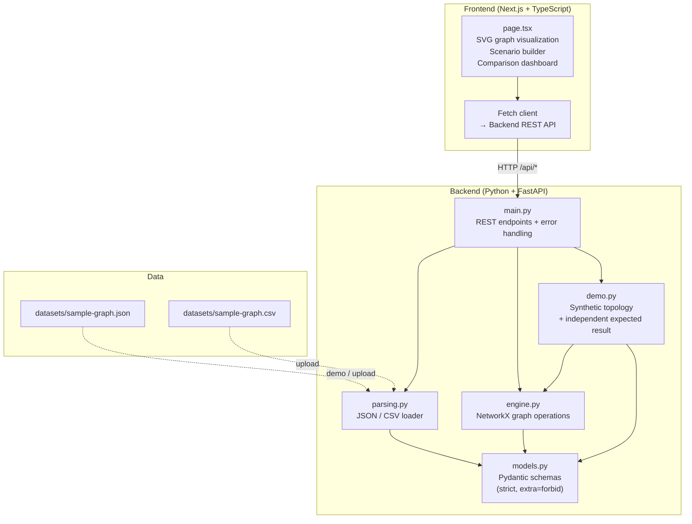
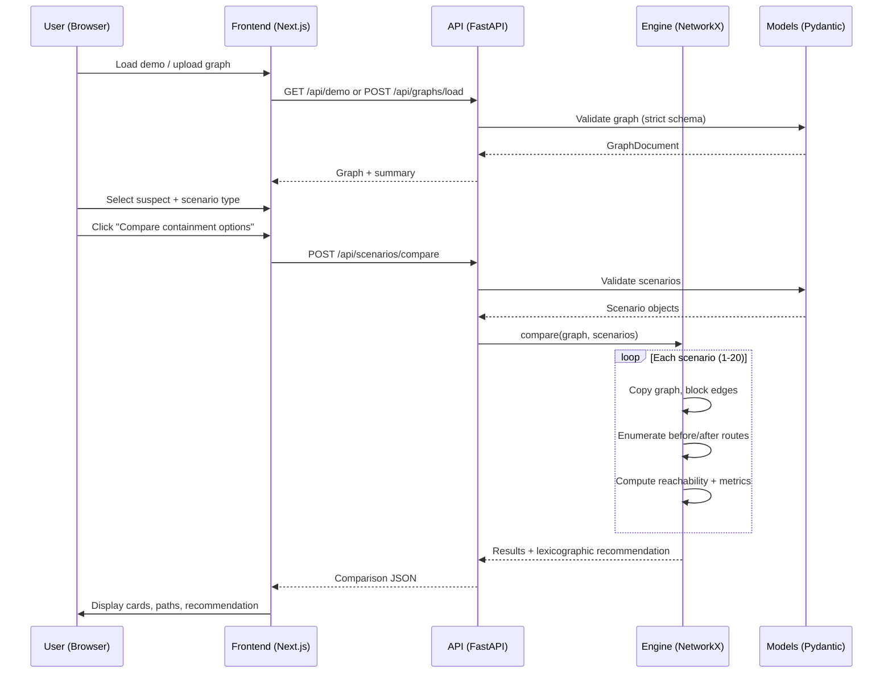

# Architecture and algorithm notes

MissionCut separates input validation, graph calculation, API transport, and presentation. Pydantic rejects unknown schema fields and invalid graph references. FastAPI applies request validation and stable JSON error responses. NetworkX MultiGraph/MultiDiGraph models directedness and independent parallel links.

## System architecture

## Request flow

## Algorithm details

For reachability and route enumeration, the engine builds an active simple-graph projection from active edges. `networkx.all_simple_paths` enumerates node-simple routes up to a hard cap; using a simple projection keeps multi-edge links from inflating route counts. The graph has at most 250 assets and 1,000 links; analysis allows at most 100 source-target pairs and 500 routes for each pair. This bounds response work while acknowledging that route enumeration is combinatorial.

Containment selection is mapped to edge IDs. Full isolation selects every link incident to a suspect asset, selective containment selects the supplied edge IDs, and custom containment unions the links incident to selected assets with explicitly selected edges. Evaluation copies the NetworkX graph and changes statuses only on that copy. The base Pydantic document is read-only to the evaluator.

Before/after output separates route counts per source/target pair, assets reachable from selected sources, critical-service reachability, links newly blocked, distinct endpoint assets affected by those links, and explicit change cost. Routes lost are the nonnegative difference of bounded before and after counts; when a cap is hit, `path_counts_truncated` signals that these may be lower bounds. Each path entry also includes the actual route node sequences so the frontend can display which specific paths were cut and which remain.

The recommendation comparator uses deterministic lexicographic sorting: maximize reachable critical services, then minimize routes lost, newly blocked links, and explicit cost. Identical tuples produce a tie. It does not use weights or probabilities.

All data is in-memory and synthetic demo data ships with the repo. The frontend only renders and requests backend evaluations; it does not carry a separate scoring implementation. Reports include a simulation disclaimer.
