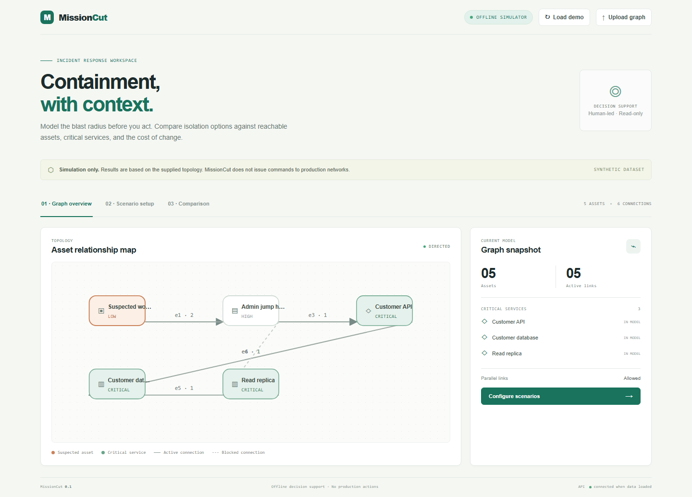

# MissionCut

MissionCut is an offline incident-response decision-support simulator. It models supplied or synthetic asset connectivity, evaluates containment scenarios on isolated graph copies, and compares impact to reachability, critical services, route counts, and explicit change cost. It never executes production network changes and does not estimate real-world attack probability.

## Architecture

- `backend/models.py` defines strict Pydantic graph and scenario contracts.
- `backend/parsing.py` accepts bounded UTF-8 JSON and CSV.
- `backend/engine.py` uses NetworkX for reachability and node-simple routes. Each scenario gets a private copy; the source document is not mutated.
- `backend/main.py` exposes the REST API and OpenAPI at `/docs`.
- `frontend/` is a responsive Next.js and TypeScript client. Graph evaluation and recommendation results come from the API.
- `datasets/sample-graph.json` and `.csv` are synthetic examples.

## Quick start

Requirements: Python 3.12+, Node.js 20+, npm. Install dependencies from the lock files:

```powershell
python -m venv .venv
.\.venv\Scripts\Activate.ps1
python -m pip install -r requirements.lock
cd frontend
npm ci
cd ..
```

Start the API in one terminal:

```powershell
python -m uvicorn backend.main:app --reload --port 8000
```

Start the web app in another terminal:

```powershell
cd frontend
npm run dev
```

Open `http://localhost:3000`. The API is at `http://localhost:8000`; OpenAPI docs are at `http://localhost:8000/docs`. Set `NEXT_PUBLIC_API_URL` before starting Next.js when the API uses another address.

## Demo and independent expected result

Select **Load demo**, then **Configure scenarios** and **Compare containment options**. The synthetic topology has two node-simple paths from the suspected workstation to the customer API: direct and through the jump host. Full isolation blocks both links touching the workstation, so those routes fall from 2 to 0. The two blocked connections have explicit costs 2 and 3 (sum 5). It also makes the API and database unreachable from that source; the read replica was already unreachable because its jump-host connection is blocked. These values are manually derived and asserted in tests.



## Graph schema

A graph JSON document has exactly these top-level fields:

```json
{"directed":true,"allow_parallel_edges":true,"nodes":[],"edges":[]}
```

Each node has a unique `id` (letters, numbers, `_ . : -`), `label`, `asset_type` (`endpoint`, `server`, `database`, `identity`, `network`, `cloud`, `service`), and optional `criticality` (`critical`, `high`, `medium`, `low`; default `medium`). Each edge has a unique `id`, existing `source` and `target` IDs, `status` (`active` or `blocked`, default `active`), optional nonnegative `change_cost`, and optional `label`.

`directed` defaults to true. In an undirected graph a connection works both ways. `allow_parallel_edges` defaults to true; distinct edge IDs may connect the same node pair. Parallel connections are independently blockable and counted, but route counts are unique node-simple routes and therefore are not multiplied by parallel links. A blocked connection is retained in the model but does not transmit reachability in either direction. Unknown fields, duplicate IDs, dangling references, unsupported CSV columns, and invalid data are rejected.

CSV is one table with header `record_type,id,label,asset_type,criticality,source,target,status,change_cost`. A `node` row uses the node columns; an `edge` row uses source/target/status/change_cost. CSV graphs default to directed with parallel links enabled.

## API

- `GET /api/health`, `GET /api/demo`
- `POST /api/graphs/validate` — validate a JSON graph body.
- `POST /api/graphs/load?format=json|csv` — parse a raw JSON or CSV upload.
- `POST /api/graphs/summary` — counts and critical services.
- `POST /api/paths` — active node-simple routes between source and target.
- `POST /api/scenarios/evaluate` — assess one containment scenario (returns actual path sequences, not just counts).
- `POST /api/scenarios/compare` — compare 1–20 scenarios using explicit lexicographic criteria.
- `POST /api/reports` — produce a backend-generated comparison report.

Errors use an `error` object with a stable code and message. Input bodies are limited to 1 MB; graphs are limited to 250 nodes and 1,000 edges. One path request returns at most 500 routes. Scenario analysis is limited to 100 source-target pairs and 500 routes per pair. Route counts can be lower bounds when this safety limit is reached, which is surfaced in results.

## Metrics and recommendation

MissionCut keeps separate: blocked connections, distinct assets touched by a newly blocked connection, sum of explicitly provided `change_cost` (missing costs count as zero, and all-missing cost is reported as zero), reachable assets, and node-simple routes. Service reachability is measured from the selected source assets; the default targets are nodes marked critical.

Recommendation ranking is lexicographic: (1) maximize critical services still reachable, (2) minimize routes lost, (3) minimize newly blocked links, (4) minimize explicit change cost. Exact ties are returned as ties. This order favors service continuity over containment breadth and should be changed only with mission context. Missing cost values, topology freshness, directionality, shared infrastructure, and service dependencies are assumptions that can change the outcome. No score is an incident probability or risk prediction.

## Development and tests

```powershell
python -m pytest -q
python -m ruff check backend tests
python tests/http_smoke.py
cd frontend
npm run typecheck
npm run lint
npm run build
```

Tests cover empty and single-node graphs, multiple and absent paths, blocked links, duplicates and invalid references, parallel and undirected connections, selective and full isolation, graph immutability across scenario runs, ties, parsing limits, API integration, report generation, and the synthetic expected result.

## Security, privacy, and limits

Use only synthetic or appropriately sanitized topology. The app is local-first and does not persist uploads; graph state is held in the browser session and requests are processed in memory. Do not upload secrets, credentials, personal data, or sensitive production maps to an untrusted deployment. Do not connect this simulator to network control systems. It has no firewall, endpoint, cloud, or device integrations. The graph captures only connectivity represented by the user; it does not model protocols, identity policy, capacity, time, or unknown dependencies.

See [SECURITY.md](SECURITY.md) for reporting issues, [CONTRIBUTING.md](CONTRIBUTING.md) for development guidance, [API.md](API.md) for the full API contract, [ARCHITECTURE.md](ARCHITECTURE.md) for architecture diagrams and algorithm notes, and [PROPOSAL.md](PROPOSAL.md) for the hackathon proposal. No license has been selected; all rights are reserved by default until the owner chooses one.
